# Organigrama de NovaPay y cómo se le habla a cada capa

Este archivo es la **guía para escribir la matriz**. La idea salió de la asesoría con el docente: cada capa de SABSA es una conversación con un cargo distinto y por eso cada fila se escribe con las palabras que ese cargo entiende. Primero ubicamos con quién hablamos (organigrama), después qué palabras usa (tabla de voces), qué se explica en cada columna y con eso narramos cada celda.

**Quiénes somos nosotros:** El equipo de arquitectura de seguridad. No somos la compañía, así que NovaPay va en tercera persona (la entidad, sus clientes, pueden captar) y el nosotros queda solo para lo que hace el equipo de seguridad (si los conectamos, le ponemos, proponemos).

El generador del Excel solo lee los archivos `1-` a `5-`, así que este no entra a la matriz.

## Organigrama

El organigrama es un supuesto del caso. Lo armamos con los cargos que la matriz ya nombraba para no inventarnos otra empresa. El color de cada cargo dice en qué capa hablamos con él.

```mermaid
---
config:
  layout: elk
---
flowchart TD
  ACC["Asamblea de Accionistas"]
  JD["Junta Directiva"]
  AUD["Auditoría Interna"]
  PRES["Presidencia"]

  VPC["VP Comercial y de Pagos"]
  GPI["Gerencia de Pagos Inmediatos<br/>(dueña del proyecto)"]
  COM["Comercial y Mercadeo"]

  VPF["VP Financiera"]
  FIN["Finanzas, Tesorería<br/>y Contabilidad"]

  VPO["VP de Operaciones y Servicio"]
  OPE["Operaciones"]
  SAC["Servicio al cliente"]
  GPF["Gerencia de Prevención<br/>de Fraude"]
  MESA["Mesa de fraude<br/>y agentes de servicio"]

  VPR["VP de Riesgos y Cumplimiento"]
  RIE["Riesgos (SIAR)"]
  CUM["Cumplimiento (SARLAFT)"]
  OPD["Oficial de Protección<br/>de Datos"]

  JUR["Jurídico"]
  TH["Talento Humano"]

  CISO["CISO"]
  ARQ["Arquitecto de Seguridad"]
  SEC["Líder de SecOps / DevSecOps"]
  ESP["Especialistas de seguridad"]
  SOC["SOC 24/7"]

  VPT["VP de Tecnología"]
  DPI["Dirección de Plataforma<br/>e Infraestructura"]
  DES["Dirección de Desarrollo"]
  ADM["Administradores de nube,<br/>de accesos y de bases de datos"]
  DEV["Desarrolladores"]

  ACC --> JD
  JD --> PRES
  JD --> AUD
  PRES --> VPC
  PRES --> VPF
  PRES --> VPO
  PRES --> VPR
  PRES --> VPT
  PRES --> CISO
  PRES --> JUR
  PRES --> TH
  VPC --> GPI
  VPC --> COM
  VPF --> FIN
  VPO --> OPE
  VPO --> SAC
  VPO --> GPF
  GPF --> MESA
  SAC --> MESA
  VPR --> RIE
  VPR --> CUM
  VPR --> OPD
  CISO --> ARQ
  CISO --> SEC
  CISO --> SOC
  SEC --> ESP
  VPT --> DPI
  VPT --> DES
  DPI --> ADM
  DES --> DEV

  subgraph EXT["Empresa extendida"]
    CLI["Clientes y comercios"]
    BR["Banco de la República"]
    SP["Sistema de pago"]
    NUBE["Proveedor de nube"]
    REG["SFC y SIC"]
  end
  JD -.-> REG
  VPC -.-> CLI
  GPI -.-> SP
  SP -.-> BR
  DPI -.-> NUBE

  classDef contextual fill:#1F4E79,color:#ffffff,stroke:#1F4E79
  classDef conceptual fill:#2E75B6,color:#ffffff,stroke:#2E75B6
  classDef logical fill:#9DC3E6,color:#000000,stroke:#2E75B6
  classDef physical fill:#C5E0B4,color:#000000,stroke:#548235
  classDef component fill:#FFE699,color:#000000,stroke:#BF9000
  classDef operacional fill:#F8CBAD,color:#000000,stroke:#C55A11
  classDef externo fill:#ffffff,color:#000000,stroke:#7F7F7F,stroke-dasharray: 4 3

  class ACC,JD,PRES,VPC,VPF,VPO contextual
  class CISO,VPR,VPT,JUR,TH,GPI,COM,FIN,OPE,RIE,CUM,OPD,AUD,GPF conceptual
  class ARQ logical
  class DPI,DES,ADM,DEV physical
  class SEC,ESP component
  class SOC,SAC,MESA operacional
  class CLI,BR,SP,NUBE,REG externo
```



| Color | Capa | Con quién hablamos |
|---|---|---|
| Azul oscuro | Contextual | Accionistas, Junta, Presidencia y vicepresidencias de negocio |
| Azul | Conceptual | El CISO con los directores y gerentes de área |
| Azul claro | Logical | El CISO con el Arquitecto de Seguridad |
| Verde | Physical | La Dirección de Plataforma e Infraestructura con Desarrollo y los administradores |
| Amarillo | Component | El Líder de SecOps / DevSecOps con los especialistas |
| Naranja | Operacional | El SOC, la mesa de fraude y el servicio al cliente |

El CISO le reporta a Presidencia y no a Tecnología porque el docente lo dijo de frente: cuando seguridad depende de tecnología "no funciona muy bien".

## Cómo baja el discurso

Cada capa es la misma conversación con un interlocutor más técnico. Arriba se habla de negocio y abajo de productos, pero el tema no cambia.

```mermaid
flowchart LR
  C1["<b>1 Contextual</b><br/>Junta y Presidencia<br/><i>Vincular a NovaPay a Bre-B<br/>de forma segura</i>"]
  C2["<b>2 Conceptual</b><br/>CISO y directores<br/><i>Toca meter a Tecnología,<br/>Jurídico y Riesgos</i>"]
  C3["<b>3 Logical</b><br/>CISO y arquitecto<br/><i>La app consume la API<br/>del sistema de pago</i>"]
  C4["<b>4 Physical</b><br/>Plataforma e Infraestructura<br/><i>Al conector le ponemos<br/>canal dedicado y cifrado</i>"]
  C5["<b>5 Component</b><br/>SecOps / DevSecOps<br/><i>Direct Connect, Istio<br/>y CloudHSM</i>"]
  C6["<b>6 Operacional</b><br/>SOC y operación<br/><i>Monitoreo 24/7<br/>de la conexión</i>"]
  C1 -->|"qué y para qué"| C2 -->|"con qué servicios"| C3 -->|"con qué controles"| C4 -->|"con qué productos"| C5 -->|"cómo se opera"| C6

  classDef contextual fill:#1F4E79,color:#ffffff,stroke:#1F4E79
  classDef conceptual fill:#2E75B6,color:#ffffff,stroke:#2E75B6
  classDef logical fill:#9DC3E6,color:#000000,stroke:#2E75B6
  classDef physical fill:#C5E0B4,color:#000000,stroke:#548235
  classDef component fill:#FFE699,color:#000000,stroke:#BF9000
  classDef operacional fill:#F8CBAD,color:#000000,stroke:#C55A11
  class C1 contextual
  class C2 conceptual
  class C3 logical
  class C4 physical
  class C5 component
  class C6 operacional
```



## Cómo se le habla a cada capa

| Nivel | Capa | Con quién hablamos | De qué se habla | Palabras que sí van | Palabras que no van | Cómo se redacta |
|---|---|---|---|---|---|---|
| 1 | Contextual | Junta, Presidencia y VP Comercial y de Pagos | Qué gana la compañía, qué arriesga, a quién le importa y para cuándo | Plata, clientes, confianza, marca, crecimiento, sanción, confidencialidad, integridad, disponibilidad | Siglas técnicas (WAF, HSM, API, MOL), productos, protocolos | Narración de negocio con la compañía en tercera persona (NovaPay quiere, podría captar) y la seguridad dicha con los tres pilares |
| 2 | Conceptual | CISO con los directores de área | Políticas, normas, riesgos, estrategias y a quién toca meter | Política, objetivo de control, riesgo, norma, dueño, custodio, Zero Trust | Productos, marcas, configuración | Reglas en impersonal (ningún pago pasa sin…) y nosotros para lo que proponemos (proponemos seis objetivos de control) |
| 3 | Logical | CISO y Arquitecto de Seguridad | Servicios de seguridad, flujos, dominios y perfiles | Servicio, flujo, dominio, perfil, API, aplicación, nube | Marcas y versiones | Descripciones en presente de cómo funciona (la aplicación consume la API, el flujo pasa por…) |
| 4 | Physical | Dirección de Plataforma e Infraestructura | De qué se compone la aplicación y qué control lleva cada parte | Base de datos, contenedores, subred, canal dedicado, firewall, cifrado, doble factor | Marcas (van en la siguiente capa) | Componente y su control, con nosotros para el control (a la base le ponemos, la app la protegemos) |
| 5 | Component | Líder de SecOps / DevSecOps | Con qué producto y qué estándar se hace cada control | Nombres de producto, protocolos, estándares | Configuración de cada máquina, lenguaje de programación | Producto por cada control en condicional porque es propuesta (quedaría en, se usaría) |
| 6 | Operacional | SOC y operación | Qué se vigila, cada cuánto y qué se hace cuando algo pasa | Turno, alerta, playbook, indicador, reporte | Justificación de negocio | Actividades en sustantivo (monitoreo, revisión, reporte) |

## Qué se explica en cada capa

Cada fila responde las mismas seis preguntas pero con otro nivel de detalle. La columna H (responsable) dice quién responde por esa fila.

| Capa | WHAT | WHY | HOW | WHO | WHERE | WHEN | Responsable (H) |
|---|---|---|---|---|---|---|---|
| Contextual | Objetivos del negocio y los activos que los sostienen | Oportunidades y amenazas | Procesos del proyecto y de la operación, con la integración segura en términos de los tres pilares | Accionistas, sponsors, áreas interesadas y empresa extendida | Sedes, alcance nacional, nube y jurisdicción | Para cuándo necesita el negocio cada objetivo | Junta, Presidencia y VP Comercial y de Pagos |
| Conceptual | Atributos medibles de cada objetivo | Objetivos de control y arquitectura de políticas | Estrategias (Zero Trust, defensa en profundidad) y seguridad en cada fase del proyecto | Dueños, custodios, usuarios y a quién toca meter | Dominios y normas que mandan en cada uno | Marco de gestión de riesgos y cuándo pesa cada riesgo | CISO con los directores de área |
| Logical | Activos de información y componentes del sistema | Políticas por dominio | Flujos y servicios de seguridad | Perfiles y modelo de confianza | Dominios de seguridad y el pedazo de norma de cada uno | Cronograma de seguridad, vigencias y plazos | CISO y Arquitecto de Seguridad |
| Physical | Diccionario de datos por clasificación | Reglas y procedimientos | Cada componente con su control | Interfaces de clientes y empleados y control de acceso | Dónde corre cada dominio en la infraestructura | Secuencia del pago, RTO y RPO | Dirección de Plataforma e Infraestructura |
| Component | Repositorios y procesadores | Herramientas de riesgo y monitoreo | Productos y protocolos de cada control | Identidades, grupos y ACL | Localizadores, nodos y conexiones | Relojes, temporizadores e interrupciones | Líder de SecOps / DevSecOps |

## Modelo de celda narrada

En el Excel cada celda va narrada en uno o dos párrafos (máximo unas 200 palabras) y los mapas mentales quedan para las slides. El modelo es la versión de la capa Contextual que escribió el compañero, pasada por el estilo del grupo. Este es el arranque de su celda WHY y cómo quedó:

| Antes | Después |
|---|---|
| La incorporación de Bre-B representa una oportunidad para que NovaPay fortalezca su competitividad y amplíe su participación en el mercado financiero colombiano. | Bre-B es una oportunidad que ya está probada. En su primer año llegó a 110 millones de llaves y 245 entidades conectadas… |
| Sin embargo, este crecimiento también supone nuevos desafíos para la organización. La inmediatez de las transacciones incrementa la importancia de prevenir situaciones como el fraude financiero… | Ese mismo crecimiento trae amenazas. Como el pago es inmediato la plata no se puede reversar y el engaño o el robo de cuentas le pegan directo al cliente. |

Qué cambió: Se quitaron las muletillas que delatan texto generado ("representa", "Sin embargo, … también supone", "incrementa la importancia de") y se metió un dato con fuente en cada idea. El resto de reglas está en `docs/estilo-redaccion.md` (sección 10).

## La misma idea dicha en cada nivel

Es el ejemplo que puso el docente con la integración a Bre-B. Sirve de patrón porque muestra cómo el discurso baja de nivel sin cambiar de tema.

| Capa | Cómo se dice |
|---|---|
| Contextual | Vincular a NovaPay a Bre-B para que sus clientes le paguen a cualquier banco al instante y de forma segura. |
| Conceptual | Para vincularlos toca meter a Tecnología, a Jurídico y a Riesgos y ningún pago sale sin autenticación fuerte. |
| Logical | La aplicación consume la API del sistema de pago y se protege con los servicios de autenticación, criptografía y antifraude. |
| Physical | La aplicación son contenedores, una base de datos y un conector. El conector sale por un canal dedicado y cifrado y a la base le ponemos firewall y cifrado. |
| Component | AWS Direct Connect para el conector, Istio para el mTLS y CloudHSM para las llaves. |
| Operacional | Monitoreo 24/7 de esa conexión y playbook de caída del sistema de pago. |

Y el otro ejemplo del docente, el de pedir plata para seguridad:

| A quién | Cómo se le dice |
|---|---|
| Al vicepresidente (Contextual) | Hay que asegurar la confidencialidad de la información de la empresa y para eso se requieren unos controles. |
| Al especialista (Component) | Un firewall delante del gateway. |

Es lo mismo pero al vicepresidente se le habla con un concepto que él entiende (confidencialidad) y no con el nombre del aparato.

## Proceso para escribir una celda

1. **Ubicar la capa** y mirar en el organigrama con quién se habla ahí.
2. **Leer la celda de arriba.** La celda nueva cuenta la misma idea un nivel más aterrizada.
3. **Narrarla con las palabras de ese cargo** en uno o dos párrafos. La compañía va en tercera persona, el nosotros es solo para lo que hace el equipo de seguridad y lo que se propone va en condicional.
4. **Meter la integración segura.** Desde Contextual hasta Component cada capa dice cómo se protege la integración con Bre-B en su propio nivel (ver la tabla de trazabilidad del README).
5. **Revisar las palabras** contra la tabla de voces. Si en Contextual aparece una sigla técnica o en Physical una marca, esa palabra está en la capa equivocada.
6. **Poner la fuente de cada cifra** en "Detalle y justificación" y en el guion.
7. **Aplicar el estilo** de `docs/estilo-redaccion.md` (pocas comas, mayúscula después de dos puntos, decimales con punto, sin muletillas de IA).

En el archivo de cada capa una celda se escribe así. Solo el texto narrado entra al Excel y los bullets son la base del mapa mental de la slide:

```markdown
## WHY — Business Risk (Opportunities & Threats Inventory)
**Qué va aquí:** ...

**En la matriz:**

Bre-B es una oportunidad que ya está probada. ...

Ese mismo crecimiento trae amenazas. ...

**Para la presentación:**
- Oportunidades:
  - Crecimiento: ...
- Amenazas:
  - Fraude: ...

**Detalle y justificación:** ...
```

## Lista de chequeo de la asesoría

La transcripción de la asesoría salió con muchos errores así que esto es lo que entendimos. Si algo no fue lo que dijo el docente se corrige aquí primero.

- **Contextual son los requerimientos y los beneficios del negocio:** Cada objetivo dice qué ganamos (plata o un beneficio para el cliente). La regulación obliga pero obliga a algo que trae beneficio.
- **La seguridad a nivel de negocio son los tres pilares:** Confidencialidad, integridad y disponibilidad de la información y de la infraestructura. Con eso el dueño ya sabe que vamos a tocar seguridad.
- **Contextual HOW a muy alto nivel:** Procesos del negocio y no la parte técnica.
- **Contextual WHO son los sponsors:** Dueños, Junta, accionistas, clientes, proveedores y las áreas interesadas en general. No son los roles del equipo del proyecto.
- **Los interlocutores cambian al bajar:** El dueño dice "eso lo hace tecnología". El CISO ya dice a quién toca meter (sistemas, legal, base de datos). Más abajo hablan arquitectos y especialistas.
- **Es arquitectura y no implementación:** Somos los arquitectos de la casa y no los que la construyen. No se baja a la configuración de cada máquina ni al lenguaje de programación.
- **Las dos capas de abajo son las que él va a preguntar:** Cada componente con su control (a la base de datos un firewall de base de datos, la conexión por un canal dedicado y cifrado, la comunicación con tokens, los usuarios con doble factor).
- **La celda de activos de información** describe los componentes del sistema (bases de datos, red, servidores).
- **La matriz es el paso previo al proyecto:** Sirve para que la seguridad no se quede por fuera del cronograma (por ejemplo la compra de licencias).
